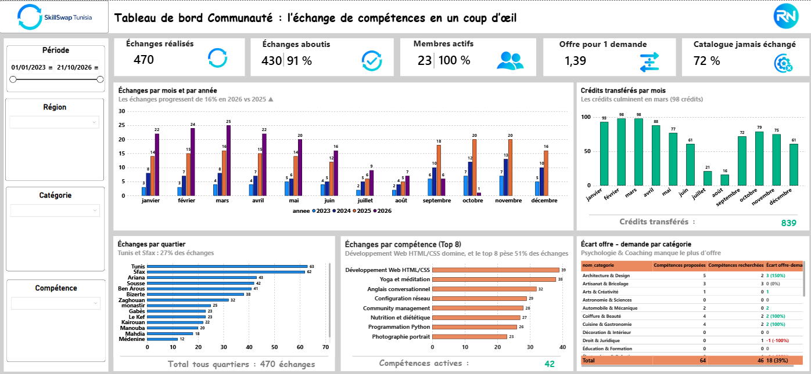
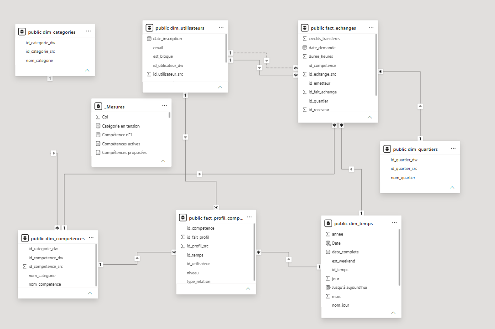

# SkillSwap Tunisia : data warehouse et dashboard Power BI

Projet de bout en bout pour une plateforme d'échange de compétences entre voisins, **sans argent**, avec des crédits-temps : base source PostgreSQL, ETL Talend, entrepôt de données en étoile, puis dashboard Power BI.



## Contexte et question métier

SkillSwap met en relation des habitants d'une même région pour échanger leurs savoir-faire (cuisine, informatique, jardinage, cours particuliers, etc.).

L'administrateur de la plateforme veut savoir :

- Les échanges progressent-ils ?
- Où et sur quelles compétences se concentre l'activité ?
- L'offre de compétences répond-elle à la demande ?
- Quelles actions mener pour faire grandir la communauté ?

## Architecture

```
Base source (PostgreSQL)  →  ETL (Talend)  →  Data warehouse (PostgreSQL)  →  Power BI
      8 tables           7 jobs + 1 job maître            5 dimensions + 2 faits        Dashboard
```

## Modèle en étoile



| Type | Tables |
|---|---|
| Dimensions | `dim_temps`, `dim_utilisateurs`, `dim_competences`, `dim_categories`, `dim_quartiers` |
| Faits | `fact_echanges`, `fact_profil_competences` |

- Les clés `_dw` sont des **clés de substitution** générées dans l'entrepôt.
- Les clés `_src` sont les clés de la base source, conservées pour la traçabilité et pour les lookups de l'ETL.
- Dans Power BI, les relations se font toujours sur les clés `_dw`.
- `fact_echanges` a deux liens vers `dim_utilisateurs` (émetteur et receveur) : le second est une relation inactive, activée en DAX avec `USERELATIONSHIP`.

## ETL Talend

Les jobs chargent d'abord les dimensions, puis les faits.

- Les faits retrouvent les clés `_dw` par des **lookups** sur les clés `_src`.
- `credits_transferes` vaut le nombre d'heures si le statut est « termine », sinon 0.
- Les chargements utilisent un **upsert** (insertion ou mise à jour).

## Dashboard Power BI

Le dashboard suit une histoire : situation, rythme, territoire, contenu, tension.

| Zone | Message |
|---|---|
| 5 cartes KPI | Échanges réalisés, échanges aboutis, membres actifs, offre pour 1 demande, catalogue jamais échangé |
| Échanges par mois et par année | Évolution 2026 vs 2025, à dates égales |
| Crédits transférés par mois | Saisonnalité de l'activité |
| Échanges par région | Répartition géographique |
| Échanges par compétence | Poids du top 8 |
| Écart offre − demande par catégorie | Où l'offre manque |

Toutes les mesures DAX sont documentées dans [`powerbi/mesures_dax.md`](powerbi/mesures_dax.md).

## Principaux constats (données de test au 21/10/2026)

- Les échanges progressent de **17 %** en 2026 par rapport à 2025, sur les mêmes dates.
- L'offre couvre globalement la demande (**1,39** compétence proposée pour 1 recherchée), mais certaines catégories manquent d'offre, comme Psychologie & Coaching et Informatique & Développement.
- **72 %** du catalogue de compétences n'a jamais été échangé.
- Le top 8 des compétences représente environ la moitié des échanges.

## Choix techniques

- **Comparaison 2026 vs 2025 à dates égales** : un taux calculé sur des périodes de longueurs différentes est trompeur, donc il est indépendant du segment Période.
- **Offre et demande traitées comme un stock** : les profils sont créés avant la période d'analyse, donc ces mesures ignorent le segment Période.
- **Top N et pourcentages** : un filtre Top N dans un visuel fausse les totaux calculés dans ce visuel. Les mesures calculent donc leur total en ignorant ce filtre.

## Limites et évolutions

- **Suppressions** : les dimensions sont chargées en upsert. Les lignes supprimées en source restent dans l'entrepôt, ce qui préserve l'historique et l'intégrité des faits. Évolutions prévues : colonne `est_actif` (suppression logique) et SCD de type 2.
- **Données de test** : le jeu de données est fictif (23 utilisateurs). Les chiffres illustrent la démarche et ne reflètent pas une activité réelle.
- **Données absentes du dépôt** : aucun jeu de données n'est publié.

## Contenu du dépôt

```
docs/      Captures du dashboard et du modèle en étoile
sql/       create_source.sql (base source) et create_dwh.sql (entrepôt)
talend/    Jobs Talend exportés, sans identifiants
powerbi/   SkillSwap.pbix et mesures_dax.md
```

## Pour reproduire le projet

1. Créer les deux bases PostgreSQL : la source et l'entrepôt.
2. Exécuter `sql/create_source.sql` sur la base source, puis `sql/create_dwh.sql` sur l'entrepôt.
3. Insérer des données de test dans la base source.
4. Importer les jobs dans Talend (Import Items), puis renseigner la connexion : hôte, port, base, utilisateur et mot de passe.
5. Exécuter les jobs dans l'ordre : dimensions, puis faits.
6. Ouvrir `powerbi/SkillSwap.pbix`, mettre à jour la source de données, puis choisir Affichage → Ajuster à la page.

## Stack technique

PostgreSQL 17 · Talend Open Studio for Data Integration · Power BI Desktop · DAX

## Auteur

**Riahi Nassim** · [LinkedIn](https://www.linkedin.com/in/nassim-riahi-92b029399/)
